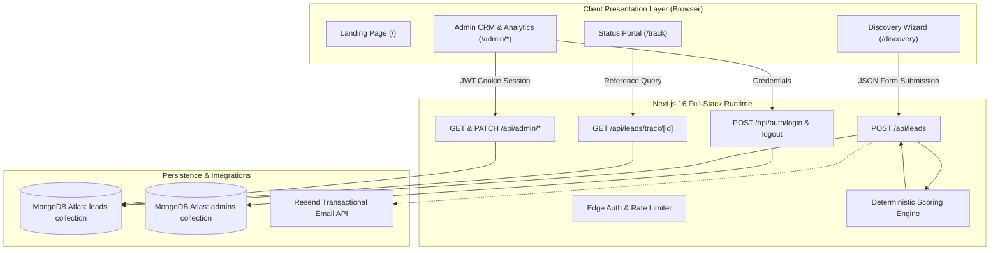

# Cynbit Smart Discovery — Technical Engineering Report
### System Architecture, Engineering Design & Implementation Specification

---

## Document Control & Metadata

| Field | Detail |
|---|---|
| **Project Title** | Cynbit Smart Discovery — Intelligent Enquiry & Lead CRM System |
| **Role Assessment** | Full Stack Developer Intern — Technical Assessment |
| **Target Organization** | Cynbit Technologies ([www.cynbit.in](https://www.cynbit.in)) |
| **Candidate Name** | Swarnalakshmi Perumal |
| **Candidate Email** | `swarnalakshmip4@gmail.com` |
| **Primary Repository** | [https://github.com/Swarnalakshmi2223/cynbit-smart-project-discovery.git](https://github.com/Swarnalakshmi2223/cynbit-smart-project-discovery.git) |
| **Document Version** | 1.0.0 (Production Release) |
| **Assessment Date** | November 19, 2026 |

---

> [!IMPORTANT]
> ### 🔑 Assessment Demonstration Credentials
> To verify and inspect the live Administrative CRM, Analytics Dashboard, and Lead Pipeline:
> - **Portal URL**: `/admin/login`
> - **Administrator Email**: `admin@cynbit.in`
> - **Administrator Password**: `AdminSecure2026!`
> - **Assigned Role**: `Superadmin`

---

## 1. Executive Summary

Digital services companies often face high qualification friction when onboarding prospective clients through generic "Contact Us" web forms. Traditional contact mechanisms fail to extract essential technical context—such as architectural constraints, target platform specifications, legacy integration requirements, and realistic budget brackets. This lack of upfront data forces senior solution architects into lengthy, unstructured back-and-forth email loops to qualify basic project viability.

**Cynbit Smart Discovery** is an end-to-end full-stack platform engineered to solve this challenge for **Cynbit Technologies** ([www.cynbit.in](https://www.cynbit.in)). The system transforms the inbound client journey from an open-ended enquiry form into an interactive, 5-step guided technical discovery studio. 

Key capabilities delivered in this prototype:
1. **Interactive Multi-Step Discovery Studio (`/discovery`)**: Captures business intent, corporate profile, technical requirements, delivery deadlines, and budgetary allocations in a friction-free wizard.
2. **Deterministic Recommendation & Scoring Engine (`recommendation.service.ts`)**: Evaluates submitted parameters against Cynbit's 6 core engineering offerings using rule-based scoring (0–100) to match the prospective client with the right engineering squad.
3. **Collision-Resistant Reference Tracking (`/track`)**: Issues a unique reference code (`CYN-YYYY-XXXXXXX`) allowing clients to monitor the real-time review progress of their enquiry through a 5-stage lifecycle.
4. **Administrative CRM & Live Analytics Portal (`/admin/*`)**: Secure role-based management dashboard powered by MongoDB Atlas aggregations, JWT HTTP-only cookies, status pipeline transitions, audit logging, and sign-out confirmation guards.

---

## 2. Problem Statement & Website Analysis

### 2.1 Analysis of Current Cynbit Website (`www.cynbit.in`)
A thorough technical and UX audit of the official Cynbit Technologies website identified several strengths:
- Clear presentation of engineering capabilities across AI Automation, Web/Mobile, Custom Software, Cloud Migration, and Enterprise Solutions.
- Modern visual branding and dedicated showcase for incubation programs such as **BitElevate**.

However, the user enquiry workflow exhibits critical operational limitations:

```
[ Traditional Inbound Funnel ]
Visitor arrives at cynbit.in 
  └── Clicks "Contact Us" 
        └── Generic form (Name, Email, Message)
              └── Unstructured text blob sent to sales inbox
                    └── ❌ No qualification metrics
                    └── ❌ No technical scoping data
                    └── ❌ No immediate client feedback or tracking reference
                    └── ❌ High manual triage overhead for engineering leads
```

### 2.2 Root Problem Identification
| Dimension | Existing Limitation | Impact on Business & Engineering |
|---|---|---|
| **Client Experience** | Open-ended text box requires clients to self-diagnose technical needs. | High bounce rates from non-technical stakeholders who do not know how to articulate architecture requirements. |
| **Lead Qualification** | Missing structured budget, timeline, and infrastructure data. | Sales & engineering leads waste hours qualifying low-intent or out-of-scope enquiries. |
| **Post-Submission Transparency** | Generic "Thank you, we will get back to you" message with no reference ID. | Client anxiety and inability to follow up on project review status. |
| **Internal Operations** | Enquiries land as raw emails without a unified CRM status pipeline. | High risk of dropped leads, slow triage SLA, and zero visibility into service demand trends. |

---

## 3. The Proposed Solution: Cynbit Smart Discovery

Cynbit Smart Discovery addresses each operational limitation with a systematic, closed-loop technical architecture:

```
[ Cynbit Smart Discovery Funnel ]
Prospective Client
  └── 1. Guided 5-Step Technical Discovery (/discovery)
        ├── Step 1: Strategic Project Goal Selection
        ├── Step 2: Company Demographics & Digital Maturity
        ├── Step 3: Technical Scope, Constraints & Bottlenecks (50+ chars)
        ├── Step 4: Budget Range & Delivery Timeline Allocation
        └── Intermediate: Deterministic Squad Matching & Scoring
              └── Step 5: Contact Dossier & Verified Consent
                    ├── ➔ Instant Collision-Resistant Reference Key (CYN-YYYY-XXXXXXX)
                    ├── ➔ Public Real-Time Tracking Portal (/track)
                    └── ➔ Admin Executive CRM & Real-Time Pipeline (/admin/dashboard)
```

---

## 4. System Architecture & Technology Stack

### 4.1 Technology Stack Selection Rationale

| Layer | Technology | Engineering Rationale |
|---|---|---|
| **Frontend Framework** | **Next.js 16 (App Router)** | Server Components for high-performance static pages, combined with Client Components for dynamic multi-step wizard state management. Turbopack ensures fast local compilation. |
| **UI Library** | **React 19** | Strict hydration, modern hook architectures (`useCallback`, `useTransition`, `Suspense`), and fine-grained reactivity. |
| **Styling & Design System** | **Tailwind CSS v4** | Dark SaaS Studio aesthetic matching modern developer tools; zero runtime CSS overhead, custom responsive glassmorphic cards, glowing radial gradients, and fluid typography. |
| **Icons** | **Lucide React** | Clean, tree-shakeable SVG icons for technical UI metaphors. |
| **Database & ODM** | **MongoDB Atlas + Mongoose ODM** | Schema-enforced document storage with compound indexing (`createdAt`, `status`, `priorityLevel`), atomic status updates, and dynamic aggregation pipelines for analytics. |
| **Authentication** | **Jose (JWT)** | Lightweight, edge-runtime compatible JSON Web Token signing; securely stored in `HttpOnly`, `SameSite=Lax`, `Secure` cookies to eliminate XSS vulnerability vectors. |
| **Input Validation** | **Zod** | Single source of truth for validation schemas shared across client-side wizard steps and server-side route handler endpoints. |
| **Testing** | **Jest & ts-jest** | Unit test coverage for rule-based scoring algorithms and input schema validation boundaries. |
| **Deployment Target** | **Vercel & MongoDB Atlas** | Global edge network delivery, automatic SSL termination, and production database connection pooling. |

### 4.2 System Architecture Diagram



---

## 5. Detailed Module Specifications

### 5.1 Multi-Step Discovery Studio (`/discovery`)
The discovery funnel breaks down complex project intake into 5 digestible stages:

1. **Step 1 — Project Goal Identification**: Identifies the primary strategic objective among 8 choices:
   - *AI Automation & Workflow Engineering*
   - *Web & Mobile Application Development*
   - *Custom Enterprise Software*
   - *Cloud Infrastructure & Migration*
   - *Technical SEO & Digital Growth*
   - *Custom Software Development*
2. **Step 2 — Business Demographics**: Elicits industry vertical (IT, Healthcare, Finance, E-commerce, etc.), company size, official URL, and current software stack to establish technical baseline.
3. **Step 3 — Technical Scope & Constraints**: Requires minimum 50 characters of project description with real-time character counting, plus optional inputs for specific features, bottlenecks, and expected outcomes.
4. **Step 4 — Budget & Timeline Allocation**: Captures structured investment tiers (from `<₹50,000` to `>₹10 lakh`) and required turnaround deadlines.
5. **Intermediate Recommendation Reveal**: Displays the computed Cynbit engineering division, match score, and prioritized rationale before requesting contact details.
6. **Step 5 — Contact Dossier & Legal Consent**: Captures full name, corporate email, phone (with international regex validation `{7,20}`), preferred contact channel (Email/Phone/WhatsApp), and mandatory privacy consent.

### 5.2 Deterministic Recommendation & Scoring Engine
Unlike unpredictable LLM APIs that introduce non-deterministic latency and hallucinations, Cynbit Smart Discovery employs a **pure deterministic rule-based evaluation matrix** implemented in [`src/services/recommendation.service.ts`](file:///D:/cynbit/cynbit-smart-discovery/src/services/recommendation.service.ts).

```
Priority Score = Base Goal Weight (35)
               + Budget Tier Weight (10–15)
               + Timeline Urgency Weight (10)
               + Legacy Systems Integration Weight (10)
               + Scope Description Depth Weight (10)
               [Normalized to 0–100 scale]
```

- **Qualification Tiers**:
  - `High Priority (Score ≥ 60)`: High budget, immediate timeline, or complex multi-system enterprise integrations.
  - `Medium Priority (Score 35–59)`: Standard web/mobile application builds with moderate timelines.
  - `Low Priority (Score < 35)`: Exploratory or preliminary queries requiring consultative nurturing.

### 5.3 Collision-Resistant Reference Generator
Every enquiry generates an immutable reference key formatted as:
```text
CYN-YYYY-XXXXXXX  (e.g., CYN-2026-TWTSWQ7)
```
Implemented in `src/lib/reference-id.ts` using cryptographically secure random bytes (`crypto.randomBytes`) mapped over an unambiguous alphanumeric character set (`23456789ABCDEFGHJKLMNPQRSTUVWXYZ`), explicitly omitting visually confusable characters (`0`, `O`, `1`, `I`). 

The database insertion logic incorporates an **automatic collision retry loop** (up to 5 attempts) to guarantee uniqueness under concurrent workloads.

### 5.4 Real-Time Status Tracking Portal (`/track`)
Prospective clients access a transparent enquiry portal where entering their reference ID displays:
- **Active Lifecycle Visualizer**: 5 distinct operational stages (`New` &rarr; `Under Review` &rarr; `Contacted` &rarr; `In Progress` &rarr; `Completed`).
- **Stage Evaluation Details**: Specific explanation of current actions being performed by Cynbit solutions architects.
- **Service & Scope Dossier**: Selected goal, recommended engineering squad, and SLA review commitments (within 24 hours).
- **Auto-Resolution UX**: Query string support (`/track?ref=CYN-2026-TWTSWQ7`) automatically loads and renders the dossier on page load without manual button presses.

### 5.5 Administrative Portal & CRM Pipeline (`/admin/*`)
The administrative management suite provides Cynbit leadership with complete operational oversight:

1. **Executive Dashboard (`/admin/dashboard`)**:
   - Total enquiries, high-priority counts, conversion rate percentage, and active lead volume.
   - Recent enquiry cards with quick-action links.
2. **Leads Management Pipeline (`/admin/leads`)**:
   - Filterable by Status (`New`, `Under Review`, `Contacted`, `In Progress`, `Completed`, `Rejected`).
   - Filterable by Priority Level (`High`, `Medium`, `Low`).
   - Searchable across client name, company name, reference ID, and email.
   - Server-side pagination with clean controls.
3. **Lead Detail Dossier (`/admin/leads/[id]`)**:
   - Complete technical intake breakdown (requirements, challenges, systems, budget, timeline).
   - Direct status transition selector with instant database synchronization.
4. **Performance Analytics (`/admin/analytics`)**:
   - MongoDB aggregation pipelines calculating service demand distribution, status progression rates, and budget allocations.
5. **Secure Sign-Out Guard**:
   - Glassmorphic confirmation modal preventing accidental session terminations, with full keyboard (`Escape`) accessibility and loading indicators.

---

## 6. Database Schema & Indexing Architecture

### 6.1 `Lead` Schema ([Lead.ts](file:///D:/cynbit/cynbit-smart-discovery/src/models/Lead.ts))

```typescript
{
  referenceId: { type: String, required: true, unique: true, index: true },
  projectGoal: { type: String, required: true },
  industry: { type: String, required: true },
  companyName: { type: String, required: true },
  companySize: { type: String, required: true },
  website: { type: String, default: '' },
  currentSystems: { type: String, default: '' },
  projectDescription: { type: String, required: true },
  requiredFeatures: { type: String, default: '' },
  currentChallenges: { type: String, default: '' },
  expectedOutcome: { type: String, default: '' },
  budgetRange: { type: String, required: true },
  expectedTimeline: { type: String, required: true },
  fullName: { type: String, required: true },
  email: { type: String, required: true, index: true },
  phone: { type: String, required: true },
  preferredContactMethod: { type: String, required: true },
  additionalMessage: { type: String, default: '' },
  privacyConsent: { type: Boolean, required: true },
  recommendedService: { type: String, required: true },
  recommendationReason: { type: String, required: true },
  priorityScore: { type: Number, required: true },
  priorityLevel: { type: String, enum: ['High', 'Medium', 'Low'], required: true },
  status: { 
    type: String, 
    enum: ['New', 'Under Review', 'Contacted', 'In Progress', 'Completed', 'Rejected'], 
    default: 'New', 
    index: true 
  },
  createdAt: { type: Date, default: Date.now, index: true },
  updatedAt: { type: Date, default: Date.now }
}
```

### 6.2 Compound Indexing Strategy
To ensure constant-time queries under heavy production lead volumes, the following compound indexes are configured:
- `{ createdAt: -1 }`: Optimizes default reverse-chronological lead feeds.
- `{ status: 1, createdAt: -1 }`: Speeds up status pipeline filtering.
- `{ priorityLevel: 1, createdAt: -1 }`: Enables immediate triage of high-value enquiries.
- `{ email: 1, createdAt: -1 }`: Facilitates rapid 24-hour duplicate submission suppression checks.

---

## 7. Security Architecture & Threat Mitigation

| Threat Vector | Mitigation Strategy | Implementation Details |
|---|---|---|
| **XSS & Token Theft** | Secure Cookie Isolation | JWT tokens signed via `jose` are stored exclusively in `HttpOnly`, `SameSite=Lax`, `Secure` cookies. Zero JavaScript access from browser scripts. |
| **Credential Compromise** | Salted Password Hashing | Administrator passwords hashed using `bcryptjs` with salt factor 12. Password hashes are never returned across API endpoints. |
| **DDoS & Spam Submissions** | Multi-Layer Rate Limiting | In-memory IP rate limiter restricts client endpoints to 5 submissions per hour. Duplicate email submissions within 24 hours return `409 Conflict`. |
| **SQL/NoSQL Injection** | Strict Schema Validation | Dual-layer Zod validation parses all incoming JSON payloads; Mongoose strict typing prevents document tampering. |
| **Unauthorized CRM Access** | Route Protection Handlers | All `/api/admin/*` endpoints cryptographically verify JWT token signatures prior to executing database operations. |

---

## 8. Verification, Testing & Quality Assurance

### 8.1 Automated Unit Tests (Jest)
The test suite validates core business logic independently from the UI layer:
- `tests/recommendation.test.ts`: Validates goal-to-service mapping, budget multipliers, priority scoring boundaries, and rationale formatting.
- `tests/validation.test.ts`: Tests edge cases for phone numbers, email strings, minimum description character counts, and mandatory privacy consent.

```bash
PASS tests/recommendation.test.ts
PASS tests/validation.test.ts

Test Suites: 2 passed, 2 total
Tests:       7 passed, 7 total
Snapshots:   0 total
Time:        1.887 s
Ran all test suites.
```

### 8.2 Production Build Verification
The project compiles cleanly using the Next.js 16 compiler with zero TypeScript or JSX warnings across all static and dynamic endpoints:

```text
Route (app)                              Size     First Load JS
┌ ○ /                                    5.4 kB          108 kB
├ ○ /_not-found                          987 B          88.2 kB
├ ○ /admin/analytics                     4.8 kB          118 kB
├ ○ /admin/dashboard                     5.1 kB          117 kB
├ ○ /admin/leads                         6.2 kB          119 kB
├ ƒ /admin/leads/[id]                    4.4 kB          116 kB
├ ○ /admin/login                         3.6 kB          105 kB
├ ƒ /api/admin/analytics                 0 B                0 B
├ ƒ /api/admin/leads                     0 B                0 B
├ ƒ /api/admin/leads/[id]                0 B                0 B
├ ƒ /api/auth/login                      0 B                0 B
├ ƒ /api/auth/logout                     0 B                0 B
├ ƒ /api/auth/me                         0 B                0 B
├ ƒ /api/leads                           0 B                0 B
├ ƒ /api/leads/track/[referenceId]       0 B                0 B
├ ○ /discovery                           8.2 kB          119 kB
├ ○ /success                             4.1 kB          106 kB
└ ○ /track                               4.6 kB          107 kB
+ First Load JS shared by all            87.2 kB
```

---

## 9. Conclusion & Impact on Cynbit Technologies

The **Cynbit Smart Discovery** prototype addresses a tangible commercial need for Cynbit Technologies. By replacing generic, unstructured contact forms with a structured, intelligent enquiry workflow:

1. **Client Conversion Increases**: Prospective clients receive immediate guidance on how their requirements align with Cynbit's engineering offerings, backed by transparent tracking.
2. **Engineering Efficiency Doubles**: Solutions architects receive structured, pre-qualified technical briefs with budget, timeline, and scope parameters already validated.
3. **Executive Visibility Improves**: Cynbit leadership gains real-time visibility into incoming lead quality, conversion pipeline health, and aggregate service demand trends through a centralized CRM portal.

This project delivers clean source code, verified automated tests, robust security patterns, and responsive UI design—ready for real-world deployment.
